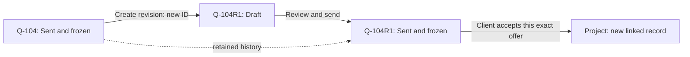

# Pulse 0.2 lifecycle states and record identity

Date: 2026-09-24. Status: design proposal incorporating the owner's latest
direction; application code and database migrations are unchanged.

Update, 2026-09-25: the [implementation plan](0.2-quote-lifecycle-implementation-plan.md)
records the owner's confirmed choices and takes precedence over tentative
policies here. In particular: acceptance and project handoff are atomic,
renewed closed work gets a new family, review is optional, validity defaults
to 30 calendar days, and the initial scope is Quotes plus handoffs/widgets/analytics.

Owner direction: distinguish workflow states from grouped final outcomes;
freeze a quote when sent; create a new linked record for a revision instead
of reopening the original; apply the historical-ownership principle across
requests, projects and later lifecycle records.

This changes the implementation approach in the earlier
[implementation map](0.2.0-implementation-plan.md). Preserve the original
[supplied design](0.2.0-design.md) as historical input. The policy recommendations
below, including exact labels and supersession timing, are proposed defaults
rather than decisions already made by the owner.

## 1. Separate progress, outcome and attention

An outcome answers how work ended. A workflow state answers what work is
happening. A computed warning answers what needs attention. These should not
compete in a single status dropdown.

| Quote list group | Displayed state or outcome | Commercial editing |
| --- | --- | --- |
| Working | Draft, In Review, Changes Requested, Ready to Send | Editable subject to review controls; relevant changes invalidate approval |
| Awaiting response | Sent | Frozen; follow-ups and response events remain available |
| Closed — won | Accepted by client | Frozen; new acceptance includes project handoff atomically |
| Closed — not proceeding | Rejected, Cancelled, Expired | Frozen; any renewed commercial work gets a new linked record |
| Previous versions | Superseded | Frozen and readable, with replacement link |

Suggested wording uses **Accepted** for the client's decision and **Approved**
only for internal review. Existing stored Approved means client acceptance and
must be mapped compatibly, not reinterpreted as internal approval.

On Hold is an operational pause with a reason and optional resume date. It
does not erase the underlying stage. Overdue preparation, follow-up due and
Needs Refresh are attention indicators, not final outcomes.

Expired as a final outcome means a recorded decision to close the opportunity
because its viable window ended. Passing a sent quote's pricing validity date
first produces Needs Refresh. A draft preparation deadline passing produces
Overdue. Neither automatically closes the record under this proposed default.

Closed is not Archived. Archiving controls list visibility; it must not erase
commercial history or outstanding handoff work.

## 2. Each revision is its own record

Recommended structure:

- `QuoteFamily`: stable commercial thread/base number, original request/project
  provenance and revision-number allocation.
- `Quote`: one individually addressable offer/version, with its own ID, unique
  quote number, `familyId`, `revisionNumber` and optional `previousQuoteId`.
- `QuoteItem`: belongs to that specific Quote record. A new revision receives
  new line IDs and copied values, with optional prior-line provenance.
- Review, generated proposal and client-response records reference the exact
  Quote and content identity.

The family groups records without merging their commercial contents. It is
not a new multi-tenant workspace. Existing LifecycleContext can remain shared
operational context, but its mutable `details` must not serve as the frozen
scope of all versions.

The current `createQuoteRevision` in
[workService.ts](../../apps/api/src/lib/services/workService.ts) saves
QuoteRevision JSON, then updates the same Quote ID with a new number, clears
`sentAt`, and sets Draft. That behavior must change. New revisions must not
rename, reopen, repurpose or move the original record's lines/files.

## 3. What freezing actually means

At send, atomically capture and lock commercial identity, client/contact/site
presentation, scope, lines, supplier evidence, financial rules/results,
validity, proposal notes, review/content identity and selected document IDs.

After send, permit separate operational activity: follow-up scheduling,
assignment, comments, response events, acceptance/rejection and project
handoff. Those actions do not edit the offer that was sent. Events record
actor, time, reason and exact version. Corrections should append evidence
rather than silently rewrite previous events.

Recommendation: remove the ordinary “undo send and reopen” path, including
its administrator exception. A mistakenly recorded send can receive an
audited correction/void event and a new replacement draft. Preserve the
original send evidence and distinguish an internal recording correction from
withdrawal of an offer actually communicated to a client. Corrected analytics
must account for those events without deleting history.

“Sent” currently records an application action; it does not prove email
delivery. Keep publication, delivery evidence and client response distinct.

Closing an unsent draft also freezes its commercial content under this
proposal. If its family is closed, a renewed attempt copies into a new linked
family with a reason. Discarding a revision draft need not close a family that
still has an outstanding sent offer.

## 4. Copy-forward and revision rules

| Copy into the new draft | Preserve as references | Reset for the new record |
| --- | --- | --- |
| Source offer's scope, commercial identity, lines, quantities, prices, supplier snapshots and proposal notes | Source quote/line IDs, family/request/project provenance, selected exact source-document versions | Review approval, client outcome, sent timestamp, generated client PDF association and resulting validity deadline |

Copied historical prices remain visible as inherited/unverified for the new
offer. Refreshing supplier prices or directory information is an explicit
draft action with a diff. Do not silently replace copied data with today's
catalog. The validity policy may initialize the draft, but a new valid-until
result is determined under the approved send policy.

Files can be referenced without copying their binaries. Do not reparent a
sent version's documents to the new draft. Prior PDFs remain readable history,
not a newly approved artifact for the new version. Copy assignments only under
an explicit default; do not duplicate old comments/tasks as new activity.

Proposed concurrency and supersession rules:

1. At most one open editable draft per family initially. Enforce this in the
   database, together with unique family/revision numbering. Parallel alternate
   offers would require an explicit later extension.
2. Creating R1 leaves R0 as the outstanding sent offer. A draft alone does not
   prove that a client was told R0 had been withdrawn.
3. Sending R1 replaces R0 as the current offer in Pulse through a recorded
   supersession event. Preserve R0's sent contents. Record actual delivery or
   withdrawal evidence separately; application state alone does not establish
   what was communicated externally.
4. Acceptance identifies an exact sent offer. Reject stale acceptance of a
   superseded offer by default and route it for deliberate reconciliation;
   do not discard evidence of the client's response.
5. Accepting R0 while R1 is still a draft records R0 as accepted, creates/links
   the project and closes the sibling draft through audited actions in the
   same family transaction.
   Reject further editing/sending of that draft. The family lock must also
   serialize concurrent acceptance, revision creation and supersession.
6. Once an offer is accepted, changes use a project-linked change-order quote
   family or an explicit recorded cancellation/correction of the acceptance.
   Never substitute a new revision silently into the accepted baseline.
7. Retry-safe revision creation, send and project handoff must not create
   duplicate records. Lock the family and relevant quote in a consistent order.

## 5. Storage responsibilities

Keep one authoritative source for each concept:

| Concept | Proposed ownership |
| --- | --- |
| Draft versus sent | Quote publication state and sent/frozen timestamp |
| Review pending/approved/changes requested | Version-bound QuoteReview records; derive displayed preparation state |
| Accepted/rejected/cancelled/expired/superseded | Typed lifecycle decision events, optionally with a current-outcome projection updated atomically |
| Open versus closed list group | Derived from outcome; avoid a separately editable group field |
| Needs Refresh/overdue/follow-up due | Computed from defined dates, outcome and business time zone |
| Exact draft content | Required content version or immutable content identity; revision number alone is insufficient |
| Current family offer/draft | Derived or transactionally maintained pointers with verified same-family membership |
| Historical payload | Validated, versioned snapshot plus constrained relational IDs for reviews/artifacts/evidence |

If review is optional, Ready to Send means readiness rules pass and review is
either validly approved or not required. Do not fabricate an approval. A
content change invalidates applicable readiness/approval, not the revision ID.

## 6. Apply the principle across the lifecycle, not identical states

| Record | Active workflow | Closed outcomes | Historical boundary and continuation |
| --- | --- | --- | --- |
| Request | Received, Reviewing, Missing Info, Site Visit Required, Ready for Quote | Converted, No Bid, Cancelled, Duplicate; Expired only if adopted | Conversion captures the intake/scope evidence and creates a distinct linked quote. Later quote revisions do not reopen the request. A new intake or material scope request can be a linked follow-up request. |
| Quote | Preparation, internal review, sent/awaiting response | Accepted, Rejected, Cancelled, Expired; Superseded versions shown in history | Sending freezes the offer. Revision creates a new Quote ID in the family. |
| Project | Ready, In Progress, Field Work; pause separately | Completed, Cancelled | Creation freezes the accepted commercial baseline, while tasks, expenses and execution progress remain live. Approved change orders add explicit baseline changes. Ordinary progress does not create a replacement project. |
| Invoice | Draft, Review, Issued/awaiting payment | Settled, Voided, subject to later billing policy | Issuance freezes billing content; payments append transactions. Corrections use explicit adjustment/replacement documents. Overdue is computed. Detailed accounting remains outside this design. |

Cross-lifecycle copying creates new records with lineage, not duplicate
ownership. A Quote remains an accepted Quote when a Project is created.
A Request remains a converted Request. Preserve source IDs and exact source
versions at every handoff.

## 7. Dashboard and reporting consequences

- Group outcome filters separately from active workflow filters. Avoid one
  dropdown containing preparation steps, final decisions and computed warnings.
- Show one family summary by default, with revision history underneath. If R0
  is sent and R1 is drafting, show both facts without counting two opportunities.
- Count pipeline opportunities by family and quote offers by version when
  explicitly requested. Count accepted commercial value once for the accepted
  offer; approved change orders are separate scope increments.
- Sent offers need a follow-up queue even though preparation is finished. The
  current dashboard excludes Sent from work widgets entirely.
- Legacy accepted quotes missing project handoff remain actionable as repair
  cases. New acceptance includes handoff atomically. Closed does not imply no
  remaining operational tasks.
- Track revision rate and close rate separately. Superseding an offer is not
  losing another deal; cancellation of a draft revision need not close a family
  while another offer is outstanding.
- Explicitly complete, cancel or transfer preparation tasks at handoff instead
  of inheriting every old overdue step into the project.

## 8. Migration and implementation sequence

1. Define shared phase/outcome/event contracts, allowed transitions, copy rules
   and content ownership. Retain adapters for existing status strings.
2. Add family and predecessor identity and new event/projection fields through
   additive migrations. Preserve existing IDs, numbers and migration history.
3. Keep existing QuoteRevision snapshots readable. Materialize historical
   versions only where their original payload is sufficient; missing values
   must not come from today's master data. Incomplete history can remain a
   clearly identified read-only legacy version until safely representable.
4. Current Quote IDs continue identifying their present version. Preserve
   legacy version URLs through a mapping. Existing lifecycle events often span
   multiple revisions under one ID: retain raw events and assign historical
   version identity only where metadata establishes it.
5. Adapt source request links, documents, collaborators, review/artifact FKs,
   project links and analytics to exact version/family semantics. The existing
   Request `relatedQuoteId` must not become a moving pointer that loses the
   originally created quote; expose latest-family navigation separately.
6. Replace in-place revision reopening, close every commercial mutation gap,
   and implement idempotent family transitions before switching the UI.
7. Rehearse migration and updater preservation checks; switch dashboards and
   lifecycle actions together. Defer removal of compatibility storage.

Historical materialization can insert additional rows into protected Quote
and QuoteItem tables. The current updater hashes the full original row set,
not just existing rows individually, so these inserts can also fail its
preservation check. Keeping legacy history in its existing read-only storage
is the safer initial compatibility path; materializing it requires a reviewed
reconciliation procedure, not disabling preservation checks.

Acceptance must prove original IDs/numbers/payloads remain unchanged after
revision, copy-forward values are exact, stale review/send is rejected, two
revision clicks create only one intended draft, acceptance/supersession races
are handled, project handoff is idempotent, and historical documents remain
accessible. No migration or application tests were executed for this design.
